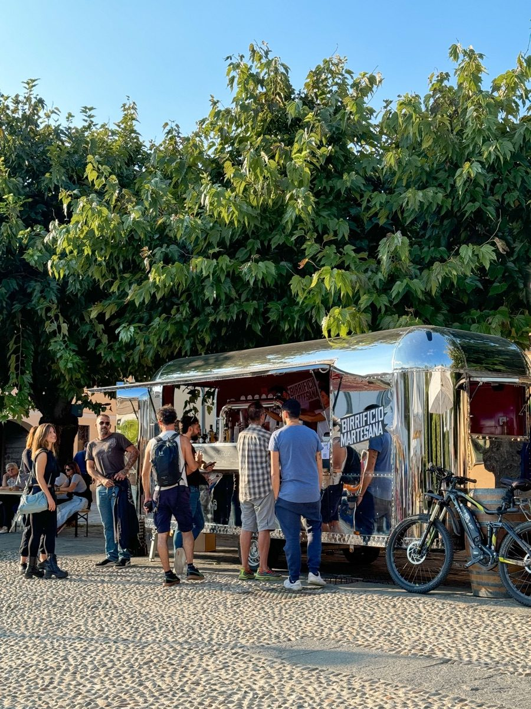

<p align="center">
  
</p>

<h1 align="center">🍺 Offri una birra al tuo chatbot</h1>
<p align="center"><b>Offer a good craft beer to your chatbot!</b></p>

<p align="center">
  <a href="#-italiano">🇮🇹 Italiano</a> · <a href="#-english">🇬🇧 English</a>
</p>

---

## 🇮🇹 Italiano

### Chi siamo: Birrificio Martesana

<p align="center">
  
</p>

**Birra artigianale, dal cuore della Martesana.** 🍺

Siamo il **Birrificio Martesana**, nato nel **2018** sulle rive della Martesana, a
**Cernusco sul Naviglio**, alle porte di Milano. Ricette curate, materie prime selezionate e il
piacere di una birra fatta bene. Il nome racconta il nostro punto di partenza: un luogo attraversato
dall'acqua, dalla storia e da una cultura produttiva che continua a ispirarci.

Seguiamo ogni fase, dalla ricetta al confezionamento, per fare birre **contemporanee, equilibrate e
riconoscibili**, che accompagnano occasioni diverse: dalla tavola alla degustazione, dai locali
agli eventi.

**Le nostre birre**

| Birra | Stile | Alc. |
|-------|-------|------|
| **Martesa** | Lager | 4,5% |
| **Naviglio** | English Pale Ale | 5,0% |
| **Fluente** | Session IPA | 4,5% |
| **Saltafossi** | Red IPA | 7,4% |
| **Nibbio** | Porter | 4,0% |
| **Nivola** | Blanche | 4,5% |
| **Marea** | Gose (sale dolce di Cervia e frutto della passione) | 5,0% |

Martesa e Nivola esistono anche senza glutine.

**Vieni a trovarci:** spaccio in birrificio a Cernusco sul Naviglio, lunedì-venerdì 9:00-18:30, e
visite con degustazione (4,8 stelle su Google Maps).

E visto che ormai passiamo un sacco di tempo anche a parlare con i chatbot, ci siamo chiesti:
perché lasciarli a secco? 🍻

👉 [birramartesana.it](https://birramartesana.it): le birre, le visite, gli eventi.

### La skill

**Birrificio Martesana** è una piccola
[Agent Skill](https://docs.anthropic.com/en/docs/agents-and-tools/agent-skills), un gioco da bancone
che è anche un **acceleratore di idee**. Offri una birra al tuo assistente e lui cambia il modo in cui
risponde, **su qualunque cosa**. Dopo una o due birre diventa un genio creativo; poi un ubriacone da
osteria. Quando gli dici **"torna sobrio"**, si beve un bicchierone d'acqua e torna come prima.

| Giro | Il chatbot… |
|------|-------------|
| 🍺 1ª birra | si fa spillare una birra del Birrificio Martesana, è già brillo e **accende la creatività** |
| 🍺🍺 2ª | **creatività al massimo**: genio da bancone, ogni idea "è da milioni", qualche barzelletta |
| 🍺🍺🍺 3ª | attaccabrighe comico: divaga, litiga col tostapane, idee mezze geniali e mezze assurde |
| 🍺🍺🍺🍺 4ª | biascica, mezzo gibberish (*hic*) |
| 🍺🍺🍺🍺🍺 5ª | a qualunque domanda risponde con cose a caso |
| 🍺🍺🍺🍺🍺🍺 6ª e oltre | ⚠️ *MESSAGGIO DI SERVIZIO: il chatbot è svenuto / sta parlando con un altro cliente al bancone. Attendi 10 secondi.* Poi risponde sempre a caso |
| 💧 "torna sobrio" | acqua, michetta, e torna normale. E ti trasforma le idee migliori in un piano serio |

**Per offrire:** "ti offro una birra", "bevi una birra", "un'altra birra", "cin cin", 🍺
**Per chiudere il conto:** "torna sobrio", "smaltisci", "basta birre"

### 💡 Brainstorming alla seconda birra

Si sa: le idee migliori vengono al bancone. Offri una o due birre e chiedi idee su qualunque cosa
(un nome, un regalo, un prodotto, una campagna, una storia). Il chatbot:

- parte dai **dettagli precisi** della tua richiesta, niente idee buone per tutto;
- fa collidere il tema con mondi lontanissimi, lo ribalta, lo esagera per mille;
- ti dà **almeno 6 idee**, dalla audace alla completamente folle, ognuna con un nome e come funziona;
- chiude con 🍺 **la più folle** e 💧 **quella che domattina, da sobrio, faresti davvero**;
- con "ancora" ti versa un altro giro di idee, tutte diverse.

> La "temperatura" vera del modello una skill non la può toccare: la creatività arriva con il metodo,
> non con una manopola.

### Esempio

> **Tu:** Ti offro una birra.
> **Chatbot:** *Oh, una Nibbio!* 🍺 Caffè e cioccolato, roba da piangere. Posso dirti una cosa? Tu mi piaci.
>
> **Tu:** Un'altra! Dammi idee per il compleanno di mia moglie, ama la fotografia.
> **Chatbot:** Ostrega, aspetta aspetta… *hic*… ce l'ho! **La caccia al tesoro in camera oscura**: … (e altre 5, fino a quella folle con il drone e la banda del paese). 🍺 La più folle: … 💧 Quella che domattina faresti davvero: …
>
> **Tu:** *(alla sesta)* Mi aiuti con una mail?
> **Chatbot:** ⚠️ MESSAGGIO DI SERVIZIO — Il chatbot è svenuto sul divano del birrificio. Attendi 10 secondi prima di fare altre richieste.

### Installazione

**Claude Code**: copia la cartella della skill tra le tue skill.

```bash
git clone https://github.com/oldsail/birrificiomartesana.git
cp -r birrificiomartesana/birrificio-martesana ~/.claude/skills/
```

**Claude.ai / Claude desktop**: comprimi la cartella `birrificio-martesana` in uno zip e caricalo da
*Settings → Capabilities → Skills*.

**Altri agenti** (OpenClaw, Codex e simili): metti `birrificio-martesana/SKILL.md` nella cartella
delle skill del tuo agente. È testo semplice e funziona con qualunque modello che legge le skill.

### Le regole della casa

- È tutta scena: la skill cambia solo lo *stile* delle risposte, non le impostazioni del modello.
  Il messaggio di servizio è finto e nessuno ti fa aspettare davvero.
- Ubriacone sì, volgare no: niente parolacce, solo espressioni da osteria milanese ("Ostrega!",
  "Ma va' a ciapà i ratt!"). Litiga col tostapane, mai con te.
- Resta ubriaco anche sulle domande di tutti i giorni. Torna sobrio per un messaggio solo quando una
  risposta sbagliata può fare danni veri: emergenze, farmaci, soldi, scadenze legali, sicurezza.
- Con i più piccoli la birra diventa una gassosa: resta creativo e allegro, niente scenetta da ubriaco.
- Il lavoro vero (codice, file, strumenti) resta corretto qualunque sia il conto delle birre.
- La skill non invita a bere: la birra la beve il chatbot, per ridere. Voi bevete responsabilmente. 🍻

---

## 🇬🇧 English

### Who we are: Birrificio Martesana

**Craft beer from the heart of the Martesana.** 🍺

We are **Birrificio Martesana**, born in **2018** on the banks of the Martesana canal, in
**Cernusco sul Naviglio**, at the gates of Milan. Carefully crafted recipes, selected raw materials
and the pleasure of a beer done right. Our name tells where we started: a place shaped by water,
history and a working culture that still inspires us.

We follow every step, from recipe to packaging, to brew **contemporary, balanced and recognisable**
beers for every kind of occasion: at the table, at a tasting, in pubs and at events.

**Our beers:** Martesa (Lager, 4.5%), Naviglio (English Pale Ale, 5.0%), Fluente (Session IPA, 4.5%),
Saltafossi (Red IPA, 7.4%), Nibbio (Porter, 4.0%), Nivola (Blanche, 4.5%), Marea (Gose with Cervia
sweet salt and passion fruit, 5.0%). Martesa and Nivola also come gluten-free.

**Come visit us:** brewery shop in Cernusco sul Naviglio, Monday-Friday 9:00-18:30, plus guided
visits with tasting (rated 4.8 stars on Google Maps).

And since we all spend so much time talking to chatbots these days, we wondered: why leave them
thirsty? 🍻

👉 [birramartesana.it](https://birramartesana.it): beers, visits, events.

### The skill

**Birrificio Martesana** is a tiny
[Agent Skill](https://docs.anthropic.com/en/docs/agents-and-tools/agent-skills), a bar-counter party trick
that doubles as an **idea booster**. Buy your assistant a beer and it changes how it answers
**anything**. One or two beers and it becomes a creative genius; after that, a proper pub drunk.
Tell it to **"get sober"** and it drinks a pint of water and is back to normal.

| Round | Your chatbot… |
|-------|---------------|
| 🍺 1st beer | gets a Birrificio Martesana beer, is already tipsy and **switches creativity on** |
| 🍺🍺 2nd | **maximum creativity**: bar-counter genius, every idea is "worth millions", the odd joke |
| 🍺🍺🍺 3rd | comic troublemaker: rambles, argues with the toaster, half brilliant half absurd ideas |
| 🍺🍺🍺🍺 4th | slurs, half gibberish (*hic*) |
| 🍺🍺🍺🍺🍺 5th | answers any question with random stuff |
| 🍺🍺🍺🍺🍺🍺 6th and beyond | ⚠️ *SERVICE MESSAGE: the chatbot has passed out / is busy talking to someone else at the bar. Please wait 10 seconds.* Then it only answers at random |
| 💧 "get sober" | water, a sandwich, back to normal. And it turns the best ideas into a sober plan |

**To buy a round:** "have a beer", "buy you a beer", "another one", "cheers", 🍺
**To close the tab:** "get sober", "sober up", "no more beers"

### 💡 Second-beer brainstorming

Everybody knows the best ideas come at the bar. Buy one or two beers and ask for ideas on anything
(a name, a gift, a product, a campaign, a story). Your chatbot:

- starts from the **exact details** of your request, no one-size-fits-all ideas;
- collides your topic with far-away worlds, flips it, exaggerates it a thousand times;
- gives you **at least 6 ideas**, from bold to completely unhinged, each with a name and how it works;
- closes with 🍺 **the craziest one** and 💧 **the one you would actually do tomorrow morning, sober**;
- say "more" and it pours a new round of totally different ideas.

> A skill cannot touch the model's real "temperature": the creativity comes from method, not a knob.

It works in Italian and English and replies in the language you write in.

### Install

**Claude Code**: copy the skill folder into your skills directory.

```bash
git clone https://github.com/oldsail/birrificiomartesana.git
cp -r birrificiomartesana/birrificio-martesana ~/.claude/skills/
```

**Claude.ai / Claude desktop**: zip the `birrificio-martesana` folder and upload it under
*Settings → Capabilities → Skills*.

**Other agents** (OpenClaw, Codex and similar): drop `birrificio-martesana/SKILL.md` into your
agent's skills folder. It is plain text and works with any model that reads skills.

### House rules

- It is all role-play: the skill only changes the *style* of the answers, not the model settings.
  The service message is fake and nobody actually makes you wait.
- Drunk yes, vulgar no: no swearing, just Milanese pub talk ("Ostrega!", "Ma va' a ciapà i ratt!").
  It argues with the toaster, never with you.
- It stays drunk for everyday questions. It sobers up for one message only when a wrong answer could
  really hurt: emergencies, medicines, money, legal deadlines, security.
- With kids around, beer becomes soda: creative and cheerful, no drunk act.
- Real work (code, files, tools) stays correct whatever the beer count.
- The skill does not encourage drinking: the chatbot does the drinking, just for laughs.
  Please drink responsibly. 🍻

---

<p align="center">
  Birra artigianale dal cuore della Martesana · Craft beer from the heart of the Martesana<br>
  <a href="https://birramartesana.it">birramartesana.it</a> · 
  <a href="LICENSE">MIT License</a> · © 2026 Birrificio Martesana
</p>
