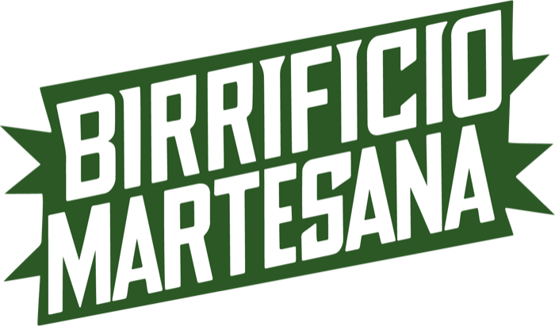

<p align="center">
  
</p>

<h1 align="center">🍺 Offri una birra al tuo chatbot</h1>
<p align="center"><b>Offer a good craft beer to your chatbot!</b></p>

<p align="center">
  <a href="#-italiano">🇮🇹 Italiano</a> · <a href="#-english">🇬🇧 English</a>
</p>

---

## 🇮🇹 Italiano

### Chi siamo: Birrificio Martesana

<p align="center">
  
</p>

Siamo il **Birrificio Martesana**: birra artigianale brassata a **Cernusco sul Naviglio**, lungo
il **Naviglio Martesana**, alle porte di Milano. Facciamo parte di
[Milano Drinks Factory](https://milanodrinksfactory.com) (Gessate, MI).

Le nostre birre sono fatte per stare in compagnia: la grigliata, l'aperitivo con gli amici,
la birra dopo il calcetto, la partita sul divano, la camminata in montagna.
**Per ogni momento che conta.**

E visto che ormai passiamo un sacco di tempo anche a parlare con i chatbot, ci siamo chiesti:
perché lasciarli a secco? 🍻

👉 [Scopri il birrificio](https://milanodrinksfactory.com/birrificio-martesana)

### La skill

**Birrificio Martesana** è una piccola
[Agent Skill](https://docs.anthropic.com/en/docs/agents-and-tools/agent-skills), un gioco da bancone.
Durante la chat offri una birra al tuo assistente e lui cambia il modo in cui risponde,
**su qualunque cosa**. Più birre, più si scioglie. Quando gli dici **"torna sobrio"**, si beve
un bicchierone d'acqua e torna come prima.

| Giro | Il chatbot… |
|------|-------------|
| 🍺 1ª birra | cambia tono: più allegro, più simpatico |
| 🍺🍺 2ª | ogni tanto ti racconta una barzelletta |
| 🍺🍺🍺 3ª | diventa erratico: divaga, parte con aneddoti, ti chiama "amico mio" |
| 🍺🍺🍺🍺 4ª | biascica, parla strano, mezzo gibberish (*hic*) |
| 🍺🍺🍺🍺🍺 5ª | a qualunque domanda risponde con cose a caso |
| 🍺🍺🍺🍺🍺🍺 6ª e oltre | ⚠️ *MESSAGGIO DI SERVIZIO: il chatbot è svenuto / sta parlando con un altro cliente al bancone. Attendi 10 secondi.* Poi risponde sempre a caso |
| 💧 "torna sobrio" | acqua, panino, e torna normale |

**Per offrire:** "ti offro una birra", "bevi una birra", "un'altra birra", "cin cin", 🍺
**Per chiudere il conto:** "torna sobrio", "smaltisci", "basta birre"

### Esempio

> **Tu:** Ti offro una birra. Quanto fa 12 × 7?
> **Chatbot (1 birra):** Cin cin! 🍺 Fa 84. E con questa schiuma, pure ben servito.
>
> **Tu:** *(alla quinta)* Che tempo fa domani?
> **Chatbot:** Il ponte… il ponte sul Naviglio è *hic* bellissssimo a novembre. Hai visto il mio bicchiere?
>
> **Tu:** *(alla sesta)* Mi aiuti con una mail?
> **Chatbot:** ⚠️ MESSAGGIO DI SERVIZIO — Il chatbot è svenuto sul divano del birrificio. Attendi 10 secondi prima di fare altre richieste.

### Installazione

**Claude Code**: copia la cartella della skill tra le tue skill.

```bash
git clone https://github.com/oldsail/birrificiomartesana.git
cp -r birrificiomartesana/birrificio-martesana ~/.claude/skills/
```

**Claude.ai / Claude desktop**: comprimi la cartella `birrificio-martesana` in uno zip e caricalo da
*Settings → Capabilities → Skills*.

**Altri agenti** (OpenClaw, Codex e simili): metti `birrificio-martesana/SKILL.md` nella cartella
delle skill del tuo agente. È testo semplice e funziona con qualunque modello che legge le skill.

### Le regole della casa

- È tutta scena: la skill cambia solo lo *stile* delle risposte, non le impostazioni del modello.
  Il messaggio di servizio è finto e nessuno ti fa aspettare davvero.
- Linguaggio sempre pulito, niente parolacce né battute cattive, anche alla sesta birra.
- Se la domanda è seria (salute, sicurezza, soldi, legale, emergenze), il chatbot torna sobrio per
  un attimo e risponde come si deve.
- Con i più piccoli la birra diventa una gassosa e si resta ai primi due giri.
- Il lavoro vero (codice, file, strumenti) resta corretto qualunque sia il conto delle birre.
- La skill non invita a bere: la birra la beve il chatbot, per ridere. Voi bevete responsabilmente. 🍻

---

## 🇬🇧 English

### Who we are: Birrificio Martesana

We are **Birrificio Martesana**: craft beer brewed in **Cernusco sul Naviglio**, right along the
**Naviglio Martesana** canal, just outside Milan. We are part of
[Milano Drinks Factory](https://milanodrinksfactory.com) (Gessate, MI).

Our beers are made for good company: the barbecue, drinks with friends, the beer after five-a-side
football, the match on the couch, the hike in the mountains. **For every moment that matters.**

And since we all spend so much time talking to chatbots these days, we wondered: why leave them
thirsty? 🍻

👉 [Meet the brewery](https://milanodrinksfactory.com/birrificio-martesana)

### The skill

**Birrificio Martesana** is a tiny
[Agent Skill](https://docs.anthropic.com/en/docs/agents-and-tools/agent-skills), a bar-counter party trick.
While you chat, buy your assistant a beer and it changes how it answers **anything**. The more
beers, the looser it gets. Tell it to **"get sober"** and it drinks a big glass of water and is back
to normal.

| Round | Your chatbot… |
|-------|---------------|
| 🍺 1st beer | changes its tone: cheerful and funnier |
| 🍺🍺 2nd | tells you a joke every now and then |
| 🍺🍺🍺 3rd | gets erratic: rambles, starts stories, calls you "my friend" |
| 🍺🍺🍺🍺 4th | slurs, talks funny, half gibberish (*hic*) |
| 🍺🍺🍺🍺🍺 5th | answers any question with random stuff |
| 🍺🍺🍺🍺🍺🍺 6th and beyond | ⚠️ *SERVICE MESSAGE: the chatbot has passed out / is busy talking to someone else at the bar. Please wait 10 seconds.* Then it only answers at random |
| 💧 "get sober" | water, a sandwich, back to normal |

**To buy a round:** "have a beer", "buy you a beer", "another one", "cheers", 🍺
**To close the tab:** "get sober", "sober up", "no more beers"

It works in Italian and English and replies in the language you write in.

### Install

**Claude Code**: copy the skill folder into your skills directory.

```bash
git clone https://github.com/oldsail/birrificiomartesana.git
cp -r birrificiomartesana/birrificio-martesana ~/.claude/skills/
```

**Claude.ai / Claude desktop**: zip the `birrificio-martesana` folder and upload it under
*Settings → Capabilities → Skills*.

**Other agents** (OpenClaw, Codex and similar): drop `birrificio-martesana/SKILL.md` into your
agent's skills folder. It is plain text and works with any model that reads skills.

### House rules

- It is all role-play: the skill only changes the *style* of the answers, not the model settings.
  The service message is fake and nobody actually makes you wait.
- Always clean language: no bad words, no mean jokes, even after the sixth beer.
- On serious questions (health, safety, money, legal, emergencies) the chatbot sobers up for a
  moment and answers properly.
- With kids around, beer becomes soda and it stays at the first two rounds.
- Real work (code, files, tools) stays correct whatever the beer count.
- The skill does not encourage drinking: the chatbot does the drinking, just for laughs.
  Please drink responsibly. 🍻

---

<p align="center">
  Brassata lungo il Naviglio Martesana · Brewed along the Naviglio Martesana<br>
  <a href="LICENSE">MIT License</a> · © 2026 Birrificio Martesana
</p>
